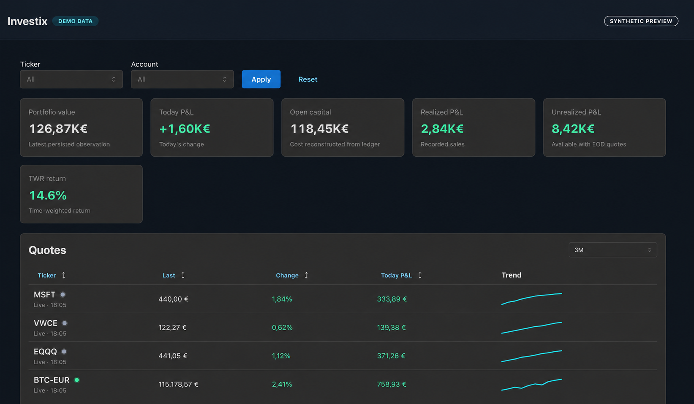

# Investix

Investix is a private portfolio-tracking application for reconstructing a securities ledger, monitoring current positions, and reading portfolio performance in EUR. It is designed for personal use on a trusted LAN/Tailscale network, with PostgreSQL as the authoritative runtime store.

**Current version:** 0.5.0 ([Semantic Versioning](https://semver.org/))

## What it does

- Imports and maintains a transaction ledger with buys, sells, transfers, splits, dividends, fees, and corrections.
- Reconstructs open quantity, average cost, realized P&L, and unrealized P&L using average-cost accounting.
- Shows dashboard KPIs, current positions, account/ticker allocations, historical performance, and benchmark comparison.
- Displays current quotes with change, Today P&L, market-open status, and a compact per-ticker trend.
- Supports ticker lookup before instrument entry and stores the preferred listing, venue, currency, and provider symbol.
- Supports up to five verified watchlist instruments without portfolio quantity; watchlist instruments are included in quotes and can be selected as benchmarks.
- Provides local UI preferences for quote refresh, chart history, KPI visibility, and KPI order.
- Runs EOD market-data refreshes in a separate worker and keeps live quote polling on-demand while the dashboard is open.

Market data is informational only. Investix does not guarantee that prices are complete, timely, or accurate; always reconcile against the broker or an authoritative source.

## Demo preview

Open `http://localhost:5173/?demo=1` to view a self-contained synthetic dashboard without login, API calls, or database access.

All values shown in this preview are synthetic and do not represent real portfolio data.

## Architecture

    Browser (React + Vite + Mantine + ECharts)
                    |
                    v
            FastAPI application  ---->  PostgreSQL
                    ^                       ^
                    |                       |
            EOD / provider worker ----------+

- frontend/: React single-page application, responsive dashboard, login, settings, and operations register.
- backend/: FastAPI API, SQLAlchemy models, ledger domain, imports, provider adapters, and worker.
- data/: local import/reference material; it is not a runtime dependency for normal reads.
- docs/operations.md: backup, restore, deployment, and operational guidance.
- PRD.md: product and source-data context.

The browser never receives the Twelve Data API key. Historical observations and KPI calculations use data persisted by the API/worker; live quotes are fetched server-side and are not written to the historical observations table.

## Quick start with Docker Compose

Requirements: Docker Engine/Desktop with Compose v2.

    cp .env.example .env
    # Replace every placeholder secret in .env.
    docker compose up -d --build

Open http://127.0.0.1:5173. The API is available at http://127.0.0.1:8000, including /docs for generated OpenAPI documentation.

The Compose file exposes the web and API on the host for trusted-LAN use. Do not publish these ports directly to the public Internet; use a private reverse proxy or Tailscale policy instead.

Useful commands:

    docker compose ps
    docker compose logs -f api
    docker compose logs -f worker
    docker compose down

## Configuration

Copy .env.example and keep .env uncommitted.

Required:

- POSTGRES_PASSWORD: database password.
- INVESTIX_SESSION_SECRET: at least 32 random characters.
- INVESTIX_ADMIN_PASSWORD: password for the configured admin user.

Optional:

- POSTGRES_DB, POSTGRES_USER, INVESTIX_DATABASE_URL: database defaults are suitable for Compose.
- INVESTIX_ADMIN_USERNAME: defaults to investix.
- INVESTIX_DEV_AUTH_BYPASS=true: development-only login bypass. Never enable it in production.
- INVESTIX_TWELVE_DATA_API_KEY: enables Twelve Data for EOD and live quotes. Keep it server-side.
- INVESTIX_LIVE_REFRESH_MINUTES, INVESTIX_LIVE_BATCH_SIZE, INVESTIX_LIVE_CREDITS_PER_MINUTE, INVESTIX_LIVE_DAILY_CREDITS, INVESTIX_LIVE_DAILY_RESERVE_PERCENT, INVESTIX_LIVE_SESSION_IDLE_MINUTES: live-quote quota and polling policy.

### Twelve Data setup

Investix currently uses Twelve Data as its optional market-data provider. To obtain an API key:

1. Create an account at [twelvedata.com](https://twelvedata.com/).
2. Open the account dashboard and copy the API key from the API-key section.
3. Add it only to the server-side `.env` file:

       INVESTIX_TWELVE_DATA_API_KEY=your_key_here

4. Recreate the API and worker containers with `docker compose up -d --build`.

Do not put the key in `frontend/`, commit it to Git, paste it into browser configuration, or replace the empty value in `.env.example`. The free plan is subject to provider credits and rate limits; Investix batches requests, caches live results, reserves daily credits, and reports quota exhaustion as a wait state.

The Twelve Data free-plan safeguards batch at most eight symbols per request, cache results, reserve daily credits, and stop polling closed markets where possible. If the provider quota is exhausted, the API preserves the last valid quote and the UI asks the user to wait for the next provider window instead of showing a blocking error.

## Application flow

1. Log in, or use the development bypass only on a private development instance.
2. Review the dashboard KPIs and current quotes.
3. Use the ticker and account filters for portfolio views; the Today P&L total remains portfolio-wide for the selected account context.
4. Use the Register page to add operations or correct/cancel an existing entry through the audit-preserving workflow.
5. Use the Settings page to choose chart/quote ranges, live refresh, KPI visibility/order, watchlist instruments, and the active benchmark. Search results are provider-verified and the first matching listing is preselected before saving; these preferences do not require a service restart.

The dashboard uses Italian number formatting: comma for decimals, dot for thousands, and EUR values. KPI amounts are compacted as K€ (for example +1,25K€).

## API surface

All protected endpoints require the session created by /api/auth/login, unless development bypass is enabled.

- GET /api/health and GET /api/health/worker: application and worker status.
- GET /api/portfolio: positions, allocations, and KPI summary; supports ticker/account filters.
- GET /api/quotes: persisted historical quote series.
- GET /api/live: on-demand live quote batch with freshness and quota metadata.
- GET /api/performance: TWR series and configured benchmark comparison.
- GET and POST /api/operations, plus /api/operations/{id}/revise and /api/operations/{id}/cancel: audited ledger workflow.
- GET /api/lookup: provider-backed instrument lookup used during entry.
- GET /api/instruments/catalog and PUT /api/instruments/watch/{ticker}: verified instrument catalog and watchlist management.
- GET /api/benchmarks and PUT /api/benchmarks/{ticker}: benchmark catalog management.

## Development and verification

Frontend:

    cd frontend
    npm ci
    npm test
    npm run build

Backend (from the backend directory so the package/test imports resolve consistently):

    cd backend
    ../.venv/bin/python -m pytest -q

The backend test suite expects a reachable test database for integration tests. git diff --check is also required before committing.

## Backups and operations

Use the supplied scripts for PostgreSQL dumps and non-destructive restore checks:

    ./scripts/backup.sh /absolute/path/investix-$(date +%F).sql.gz
    ./scripts/restore.sh /absolute/path/investix-2026-10-14.sql.gz investix_restore_check

Read docs/operations.md before changing retention, restoring data, or exposing the service on another network. The database volume is named investix-postgres; deleting it destroys the runtime ledger unless a verified backup exists.

## Current scope and future work

The current release is intentionally a single private portfolio. Multi-portfolio support is documented as a future design in docs/superpowers/plans/2026-10-14-multi-portfolio.md. Other implementation plans and decisions are kept under docs/superpowers/.

## License and disclaimer

This repository is intended for private/personal use. No investment advice is provided. Market data can be delayed, incomplete, or wrong; verify important values independently before making financial decisions.
